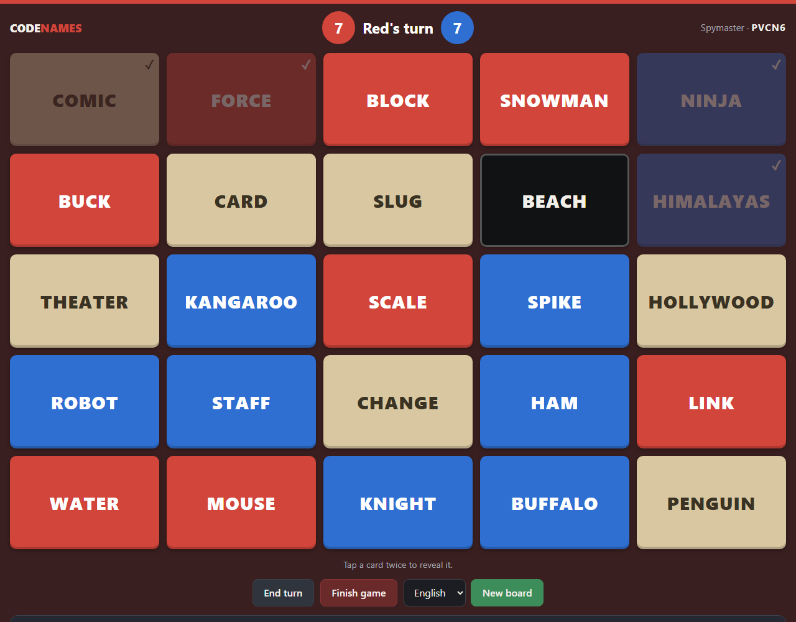
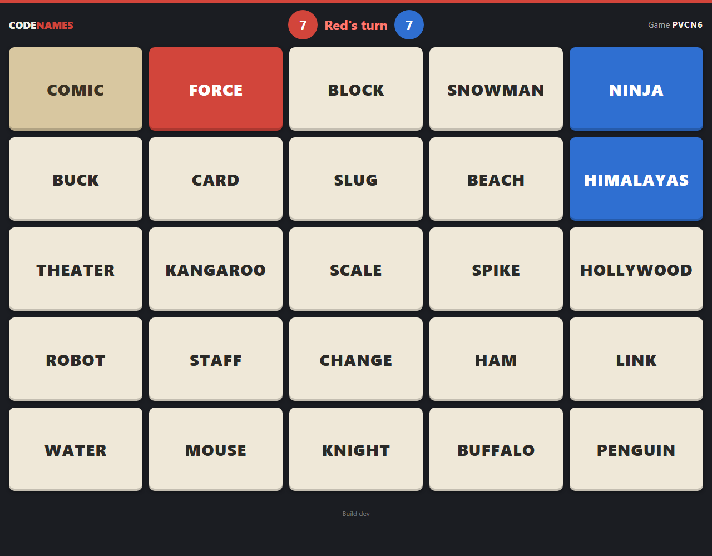

# Codenames

[](https://github.com/FeaXR/CodeNames/actions/workflows/docker.yml)
[](LICENSE)

A self-hosted Codenames board for playing around a table. The spymasters get the full key on their own devices; the players see the board on a TV, laptop, or their phones. No accounts, no installs — just open a link.

| Spymaster view | Player view |
| --- | --- |
|  |  |

## Features

- **Spymaster view** – the full key (red, blue, neutral, assassin). Tap a card twice to reveal it, end the turn, finish the game, or deal a new board. The page background takes the color of the team whose turn it is.
- **Player view** – unrevealed cards stay neutral; a card shows its team color only once it's revealed. When the game ends, the whole key is shown.
- **Any number of devices** – both spymasters open the same spymaster link, and players can open the player link on as many screens as they like. Every device stays in sync automatically.
- **Rules built in** – the starting team gets 9 cards and the other 8, with 7 bystanders and 1 assassin. A wrong guess passes the turn, the assassin loses the game, and finding all your agents wins it.
- **Easy sharing** – the spymaster page has links and QR codes for the players and for the second spymaster.
- **Multiple languages** – English and Hungarian (Magyar) word lists included, and adding another language is a single text file.
- **Secret key stays secret** – the spymaster link contains a random token, so players can't reach the key by guessing the URL.

## How to play

1. Open the app and click **Create game**. You land on the spymaster view.
2. Expand **Share links & QR codes**. Send the spymaster link to the other spymaster, and open the player link on the shared screen or players' phones (or have them enter the 5-letter game code on the home page).
3. Spymasters give clues as usual. When a team guesses a word, a spymaster taps that card twice to reveal it. Everyone's board updates within a couple of seconds.
4. Use **End turn** when a team stops guessing, and **New board** for the next round. The links stay the same between rounds.

## Running with Docker

A ready-made image is published to the GitHub Container Registry:

```bash
docker run -d --name codenames -p 8080:8080 -e APP_KEY="base64:$(openssl rand -base64 32)" -e APP_URL="http://localhost:8080" -v codenames-data:/data ghcr.io/feaxr/codenames:latest
```

Then open <http://localhost:8080>.

The image runs Nginx + PHP-FPM on port **8080** and keeps its SQLite database in `/data`. Database migrations run automatically when the container starts.

### Docker Compose / TrueNAS SCALE

[`compose.yaml`](compose.yaml) is a complete example. On TrueNAS SCALE:

1. Generate an app key: `echo "base64:$(openssl rand -base64 32)"`
2. Go to **Apps → Discover Apps → Custom App → Install via YAML** and paste `compose.yaml`.
3. Fill in `APP_KEY`, and set `APP_URL` to the address people will use to reach the game (it's used for the share links and QR codes).
4. If you use a host path instead of the named volume for `/data`, make sure it's owned by UID/GID `33` (`www-data`).

`compose.yaml` sets `pull_policy: always`, so a redeploy always fetches the newest `latest` image. Every page shows the commit it was built from in its footer (`Build abc1234`), which makes it easy to check which version a server is running.

### Configuration

| Variable | Default | Description |
| --- | --- | --- |
| `APP_KEY` | – | **Required.** Laravel encryption key (`base64:` + 32 random bytes). |
| `APP_URL` | – | Public URL of the app, used for share links and QR codes. |
| `CODENAMES_DEFAULT_LANGUAGE` | `en` | Word list preselected when creating a game. |
| `CODENAMES_POLL_INTERVAL` | `1500` | How often each device checks for updates, in milliseconds. |

The app trusts `X-Forwarded-*` headers, so it works behind a reverse proxy that terminates HTTPS.

## Word lists

Word lists live in [`resources/words`](resources/words), one word per line. Lines starting with `#` are ignored, and duplicates are removed automatically.

| File | Language |
| --- | --- |
| [`en.txt`](resources/words/en.txt) | English |
| [`hu.txt`](resources/words/hu.txt) | Magyar |

To add a language, add a `{code}.txt` file with at least 25 words (a few hundred is better), then give it a display name in [`config/codenames.php`](config/codenames.php). A file without a configured name still works and shows up under its code.

## Development

Requires PHP 8.3+ and Composer. No Node.js build step is needed; the CSS and JavaScript are plain files in [`public`](public).

```bash
composer setup
php artisan serve
```

Run the tests with:

```bash
php artisan test
```

Where things live:

- [`app/Models/Game.php`](app/Models/Game.php) – board generation and game rules
- [`app/Http/Controllers/GameController.php`](app/Http/Controllers/GameController.php) – pages and spymaster actions
- [`app/Support/WordList.php`](app/Support/WordList.php) – word list loading
- [`resources/views`](resources/views) – Blade templates for the home, spymaster and player pages
- [`public/js/board.js`](public/js/board.js) – board rendering and live updates
- [`public/css/app.css`](public/css/app.css) – styles

### Releases

Every push to `main` runs the tests and publishes `ghcr.io/feaxr/codenames:latest`. Pushing a version tag such as `v1.2.3` also publishes `1.2.3` and `1.2`.

## Disclaimer

This is an unofficial fan project for personal use. It is not affiliated with or endorsed by Czech Games Edition. *Codenames* is a trademark of Czech Games Edition — if you enjoy playing, please support them by buying the board game.

## License

[MIT](LICENSE)
